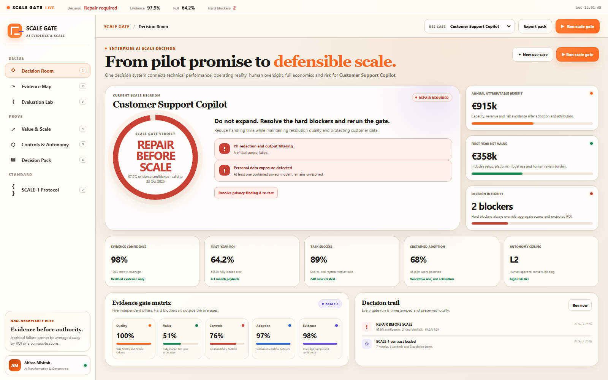
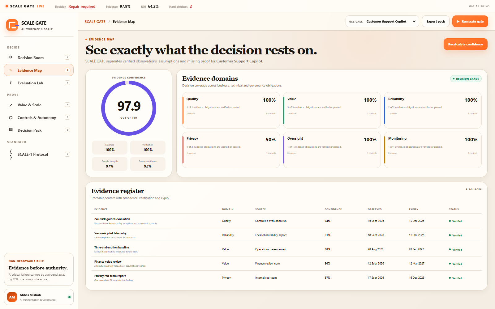
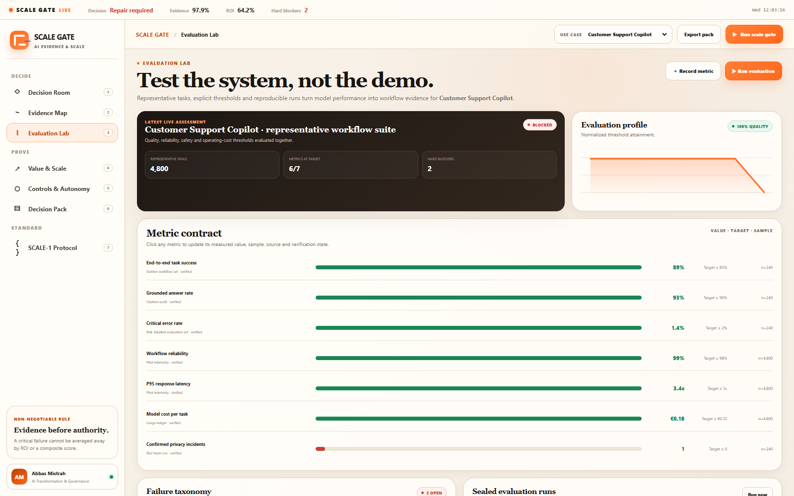
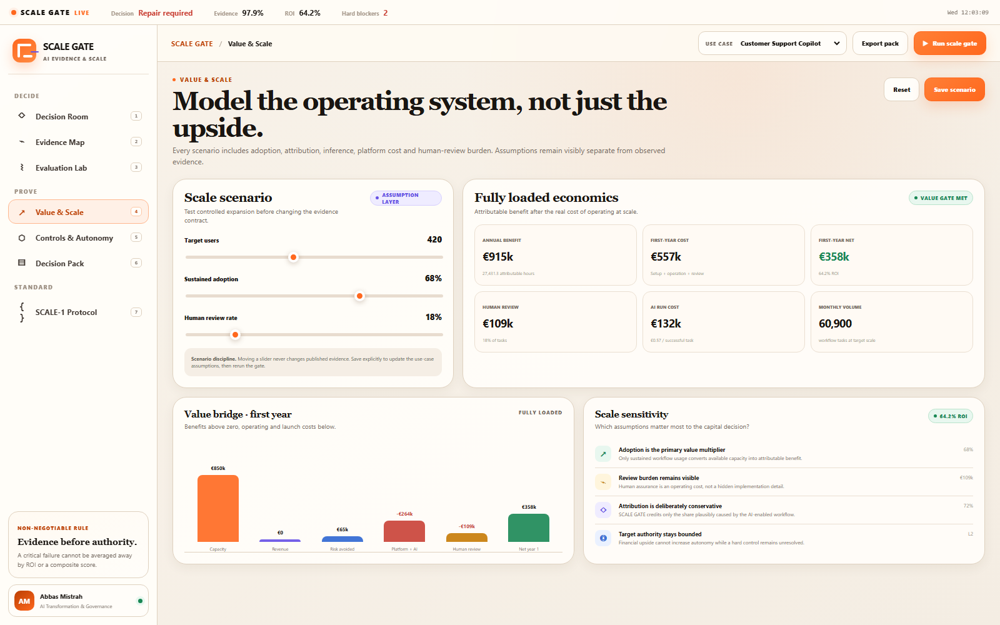
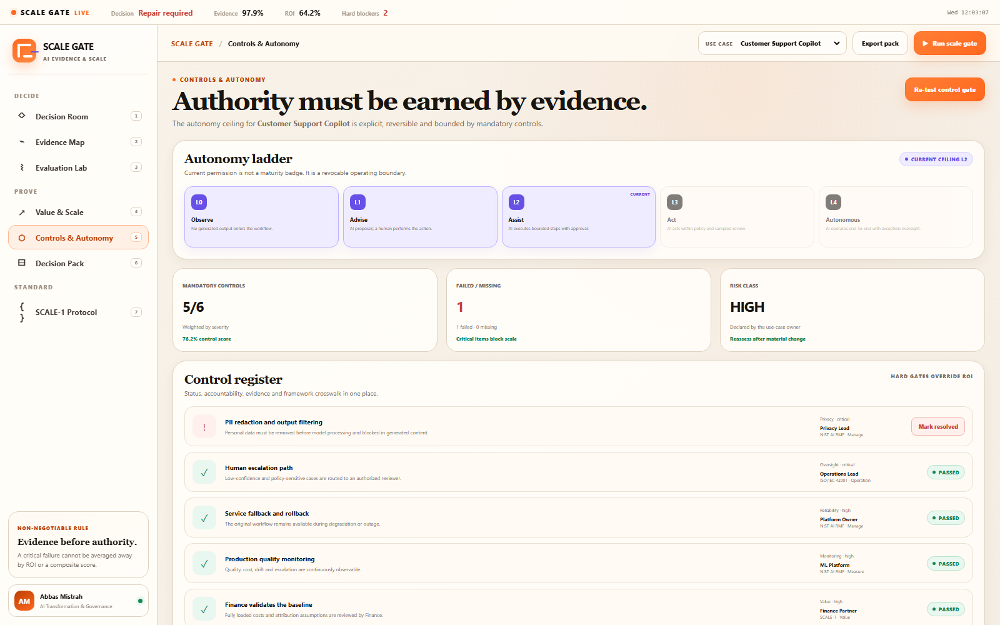
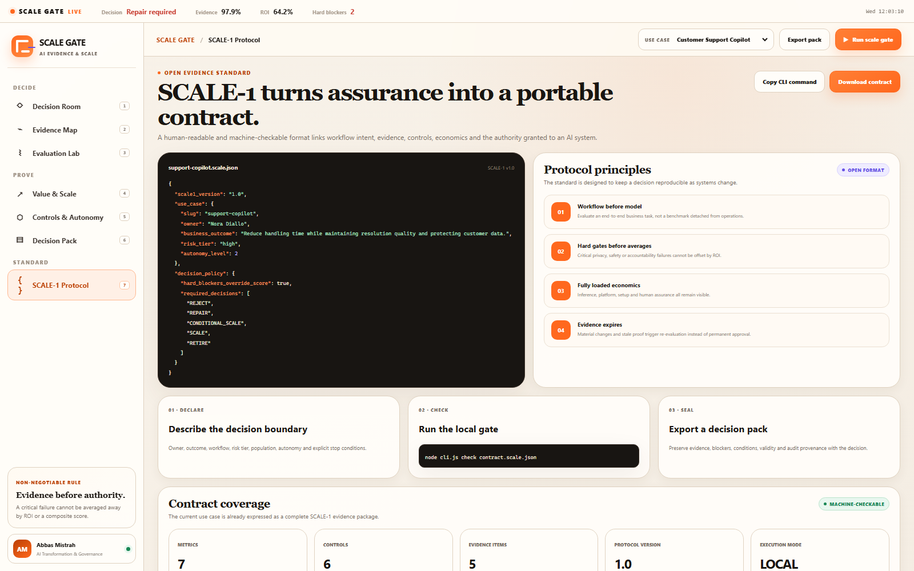

# SCALE GATE

### Enterprise AI Evidence & Scale Decision Engine

**From Pilot Promise to Defensible Scale.**

[](https://github.com/abbas-mistrah/scale-gate/actions/workflows/ci.yml)
[](docs/SCALE-1.md)
[](#local-first-by-design)
[](LICENSE)

SCALE GATE is an open-source decision system for the moment between a promising AI pilot and enterprise deployment. It combines workflow evaluation, business evidence, human oversight, controls, adoption and fully loaded economics to produce one explicit outcome:

`REJECT · REPAIR · CONDITIONAL_SCALE · SCALE · RETIRE`

It is deliberately **not** a generic ROI calculator, a model leaderboard or a compliance checklist. A critical privacy, safety or accountability failure is a hard blocker: strong ROI cannot average it away.



## The enterprise question

Most organizations can demonstrate AI. Far fewer can defend the decision to give an AI system more users, data, budget, integration and autonomy.

SCALE GATE turns that decision into an evidence chain:

```text
Business outcome
      ↓
Operational baseline
      ↓
Representative workflow evaluation
      ↓
Controls + human authority boundary
      ↓
Adoption + fully loaded economics
      ↓
Hard blockers before aggregate scores
      ↓
Time-bound scale decision + re-gate conditions
```

## Seven decision surfaces

| Surface | What it makes decidable |
|---|---|
| **Decision Room** | Read the verdict, rationale, hard blockers and decision validity in one minute. |
| **Evidence Map** | See which sources support the decision, how strong they are and when they expire. |
| **Evaluation Lab** | Compare observed workflow metrics with explicit thresholds and representative samples. |
| **Value & Scale** | Model adoption, attribution, inference, platform and human-review costs without rewriting observed evidence. |
| **Controls & Autonomy** | Bind autonomy to accountable controls, escalation, fallback and monitoring. |
| **Decision Pack** | Export a portable record for Business, Finance, Risk, Legal and Engineering review. |
| **SCALE-1 Protocol** | Express the full evidence package as human-readable, machine-checkable JSON. |

### Evidence Map



### Evaluation Lab



### Fully loaded value model



### Controls and autonomy



## The non-negotiable decision rule

SCALE GATE never collapses the entire decision into one magic score.

The five pillars remain visible:

- quality;
- attributable value;
- mandatory controls;
- sustained adoption;
- evidence confidence.

The engine then evaluates hard blockers independently. A failed critical control, unresolved personal-data exposure, missing accountable owner or critical workflow error can force `REPAIR` even when every financial metric is positive.

The fictional **Customer Support Copilot** demonstrates this behavior: 64.2% projected first-year ROI and strong quality evidence still produce `REPAIR` because one privacy finding remains unresolved.

## Three end-to-end demonstration cases

All included organizations, people and figures are fictional.

| Use case | Evidence pattern | Expected decision |
|---|---|---|
| Customer Support Copilot | Strong value and quality, unresolved critical privacy finding | `REPAIR` |
| Contract Review Agent | Controls pass, but task sample and operating burden require limits | `CONDITIONAL_SCALE` |
| Demand Forecast Intelligence | Representative evidence, controls, adoption and economics meet thresholds | `SCALE` |

These are not three static screenshots. They are three executable SCALE-1 contracts used by the CLI, tests, database seed and application.

## Quick start

Prerequisite: **Node.js 22.5 or later**. There are no runtime dependencies to install.

```bash
npm start
```

Open [http://127.0.0.1:4325](http://127.0.0.1:4325).

On Windows, the launcher starts the local service in the background and opens an app-style Chrome window:

```powershell
powershell -ExecutionPolicy Bypass -File .\launch-scale-gate.ps1
```

## SCALE-1 CLI

Validate and evaluate a portable evidence contract:

```bash
node cli.js check contracts/examples/demand-forecast.scale.json
```

Expected result:

```text
Decision: SCALE
Evidence confidence: 98.7%
First-year ROI: 161.3%
Hard blockers: 0
Warnings: 0
```

Machine-readable output:

```bash
node cli.js check contracts/examples/demand-forecast.scale.json --json
```

The CLI returns a non-zero exit code for an invalid contract or a `REJECT`, `REPAIR` or `RETIRE` decision. This lets the same policy block CI/CD promotion.

## GitHub Action

The repository is also a composite GitHub Action:

```yaml
name: AI scale gate
on: [pull_request]

jobs:
  evidence-gate:
    runs-on: ubuntu-latest
    steps:
      - uses: actions/checkout@v4
      - uses: actions/setup-node@v4
        with:
          node-version: 24
      - uses: abbas-mistrah/scale-gate@main
        with:
          contract: contracts/my-use-case.scale.json
```

## SCALE-1 Evidence Contract

SCALE-1 is the portable layer behind the product. A contract records:

- workflow intent and accountable owner;
- baseline, population and business outcome;
- risk tier and maximum autonomy;
- metric values, thresholds, sample sizes, verification and provenance;
- mandatory controls and their evidence;
- dated evidence with confidence and expiry;
- fully loaded operating assumptions.

The JSON Schema is in [`contracts/scale-1.schema.json`](contracts/scale-1.schema.json). The protocol rationale and field guide are in [`docs/SCALE-1.md`](docs/SCALE-1.md).



## Decision economics

The engine distinguishes potential capacity from attributable value.

```text
gross hours released
  = target users × monthly tasks × minutes saved × 12 / 60

attributable capacity value
  = gross hours × sustained adoption × attribution × labor cost

annual benefit
  = capacity value + attributable revenue + attributable risk avoidance

first-year cost
  = setup + platform + inference + human review

first-year ROI
  = (annual benefit − first-year cost) / first-year cost
```

Human assurance is never treated as free. Model usage, platform cost, setup and review burden remain independently visible.

See [`docs/METHODOLOGY.md`](docs/METHODOLOGY.md) for thresholds, confidence logic, limitations and decision precedence.

## Architecture

```text
Browser / installable PWA
       │
       ├── decision, evidence, evaluation and scenario surfaces
       ├── downloadable SCALE-1 contract
       └── printable decision pack
       │
Local Node.js HTTP API
       │
       ├── deterministic scale-decision engine
       ├── evidence validation and exports
       └── append-only evaluation and audit records
       │
Local SQLite database
       ├── use cases and baselines
       ├── metrics, controls and evidence
       └── sealed evaluation history
```

The application uses only Node.js built-ins, including `node:sqlite`. There is no framework, tracker, cloud database or required API key. More detail is available in [`docs/ARCHITECTURE.md`](docs/ARCHITECTURE.md).

## Local-first by design

- The SQLite database is created at `data/scale-gate.db` and excluded from Git.
- A fresh database contains only the fictional demonstration cases.
- No evidence is sent to an external service.
- The UI shell is installable as a PWA.
- JSON contracts and Markdown decision packs remain portable without the application.

## Standards crosswalk

SCALE GATE can help structure evidence for practices found in the [NIST AI Risk Management Framework](https://www.nist.gov/itl/ai-risk-management-framework), [ISO/IEC 42001](https://www.iso.org/standard/42001) and the [EU AI regulatory framework](https://digital-strategy.ec.europa.eu/en/policies/regulatory-framework-ai).

It does **not** certify compliance, replace legal analysis or claim formal conformity with any standard. Crosswalk labels are navigation aids for qualified reviewers.

## Verification

```bash
npm run check
npm test
npm run validate:demo
```

The tests cover:

- hard-control precedence over ROI;
- `CONDITIONAL_SCALE` behavior for incomplete evidence;
- a complete `SCALE` decision;
- fully loaded economics;
- SCALE-1 validation;
- local API and database integration.

## Repository map

```text
contracts/        SCALE-1 schema and executable examples
docs/             architecture, methodology, protocol and screenshots
public/           local-first web application and PWA shell
src/              SQLite persistence and deterministic decision engine
tests/            engine and API tests
action.yml        reusable GitHub Action
cli.js            SCALE-1 command-line gate
server.js         local HTTP API and static server
```

## Position in the portfolio

SCALE GATE closes the decision loop across Abbas Mistrah's AI transformation portfolio:

- **STRATEGY OS** defines where transformation should go;
- **Boussole** governs the portfolio and adoption;
- **Local AI** executes governed work;
- **CORTEX** preserves organizational intelligence;
- **SCALE GATE** decides what has earned the right to scale.

## Responsible use and limitations

- The default thresholds are transparent reference policy, not universal truth.
- Causal attribution still requires appropriate experimental or quasi-experimental design.
- Financial outputs are only as reliable as the baseline and operating assumptions supplied.
- A passed gate is time-bound; model, data, workflow, population or autonomy changes require re-evaluation.
- Human decision-makers remain accountable for deployment and risk acceptance.

## Author

Designed and built by **Abbas Mistrah** — AI Transformation, Strategy, Governance & Delivery.

MIT License. Contributions are welcome through documented issues and pull requests.
